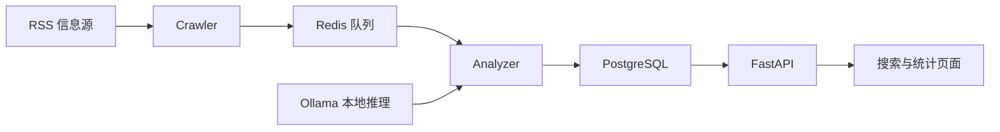

[本地 AI 信息看板](https://github.com/ywx920/osint-local-ai-dashboard)是一个围绕公开 RSS 信息构建的学习与工程实验：采集条目，完成分类和结构化摘要，再用页面展示搜索、统计与风险标签。

它的目标，是把信息处理过程组织成几个职责清晰的服务。

## 从信息源到页面

采集端、分析端和展示端分别运行，能够减少相互等待。页面读取数据库中的结果，采集任务不需要等用户打开网页才开始工作。

## 结构化结果比一段长文本更容易使用

项目把摘要、可能影响、风险级别和建议动作分开保存。这样，展示层可以按字段排版，后续也更容易增加筛选或统计。

与此同时，原文来源和链接仍然需要保留。模型生成的摘要和风险标签适合作为阅读线索，事实判断仍应回到原始信息核对。

## 本地推理也是应用集成问题

接入 Ollama，并不意味着应用只剩下一次模型调用。服务地址、依赖、数据库字段和异常情况，都需要与其他容器协作。

Docker Compose 用来组织这些组件。Python 实现采集和分析逻辑，Redis 连接处理环节，PostgreSQL 保存结果，FastAPI 提供页面和接口，Chart.js 完成统计展示。

这一项目体现的是本地模型的接入与应用组织，不涉及基础模型训练。

## 页面渲染和配置也属于工程的一部分

RSS 标题、摘要和模型输出都可能包含任意文本，展示时不能直接当作 HTML 执行。当前页面使用文本节点渲染这些内容，并限制外链的协议类型。

数据库密码也不放在代码里，而由本地配置注入。数据库、队列和看板的主机端口默认限制在本机；远程访问需要另行安排受控入口。

这些处理让演示工程更适合继续维护，也避免“一键启动”同时带来不必要的暴露。

## 当前进度

公开工程已具备采集、分类、摘要、筛选与统计页面。告警通知、事件聚类和趋势分析仍列为后续方向，尚不把它们写成已经完成的能力。

仓库与部署说明：[osint-local-ai-dashboard](https://github.com/ywx920/osint-local-ai-dashboard)。
