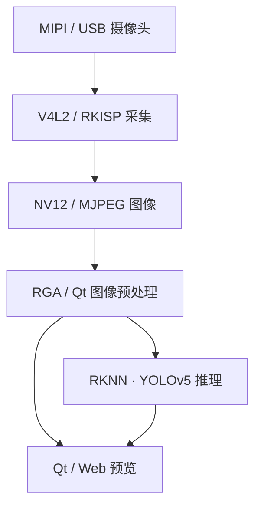

[RK3588 多路摄像头项目](https://github.com/ywx920/rk3588-multi-camera-demo)把 MIPI/USB 摄像头、Linux 采集接口、图像预处理、RKNN 推理与 Qt/Web 预览放在同一个工程里。

这个项目的组织方式是先验证最小采集，再叠加显示和推理，避免所有问题都在一个大程序里排查。

## 一帧图像经过哪些环节

每个环节都可能影响最终画面。节点是否选对、像素格式是否一致、stride 和缓冲区大小是否正确，与模型能否运行一样重要。

## 用最小采集程序划分问题

工程中的 Minimal 部分用于检查摄像头节点、格式、帧序号、采集帧率和原始输出。遇到 Qt 或 Web 没有画面时，先回到这一层，有助于判断问题是在摄像头链路还是应用逻辑。

设备发现也需要考虑稳定性。直接依赖一个固定的 `/dev/videoN` 编号，可能在环境变化后指向不同节点。项目中使用稳定别名或按设备信息查找的方式区分摄像头。

## 采集、推理和显示不必同频

多路预览的关键之一，是不要让旧帧越积越多。

当前 Qt 工程使用集中推理调度，每路保留最新帧，并提供逐路和全局的推理控制。对于实时预览，及时处理新画面比持续追赶历史队列更有意义。

摄像头软暂停时，工程仍继续回收 V4L2 缓冲，避免在反复启停后让采集链路进入等待状态。Web 部分也会根据订阅情况跳过不必要的转换、推理和编码工作。

## 硬件加速需要验证最终输出

工程使用 RGA 做图像处理，RKNN 负责 NPU 推理。JPEG 编码的实验则保留了回退路径：编码结果需要能够完整解码并正确显示，不能只依据文件头判断成功。

这也是一个实用的验证顺序：先确保帧内容正确、退出可恢复，再观察资源占用与长期运行，最后比较加速前后的效果。

## 当前边界

Qt 和 Web 不能同时独占同一个摄像头节点。Web 的可靠编码路径仍以已验证的软件 JPEG 路径为基础，硬件编码和更多路数的扩展还需要进一步验证。RKNN 模型、运行库和驱动版本也必须配套。

公开版本默认将 Web 服务限制在本机监听，远程预览可通过 SSH 隧道访问。现场采集图像只用于本地测试，不随博客发布。

源代码、模型准备与调试文档：[rk3588-multi-camera-demo](https://github.com/ywx920/rk3588-multi-camera-demo)。
